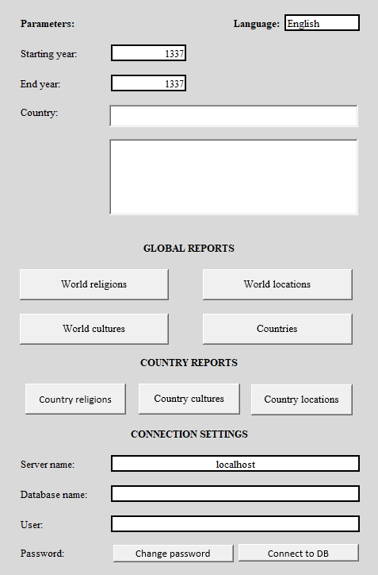
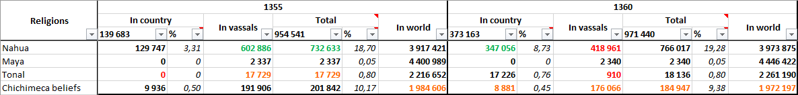
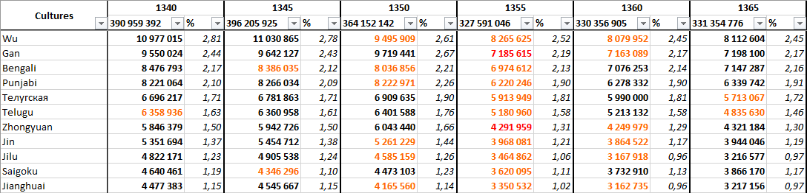

# EU5Statistics: Excel Reports (XLSM)

**English** | [Русский](XLSM_GUIDE.ru.md)

This document describes how to use the Excel workbook with macros (XLSM) to visualize and analyze data collected by the Python parser into a PostgreSQL database.

The XLSM file acts as a client that connects to the database via ODBC, executes SQL functions, and builds ready-to-use analytical reports.

📥 **Download the Excel file:** [EU5Statistics.xlsm (latest release)](https://github.com/EArboles/EU5Statistic/releases/latest/download/EU5Statistics.xlsm)

## Requirements

1. **Microsoft Excel** (2016 or newer, Windows). *Note: VBA macros and database connections will not work in LibreOffice or Excel Online.*
2. **PostgreSQL database** populated by the Python parser (migrations must be applied and at least one save file processed).
3. **PostgreSQL ODBC driver** (psqlODBC). If not installed, the Excel file will prompt you to install it upon launch.

## First Launch (Connection Setup)

1. Open `EU5Statistics.xlsm` and be sure to click **"Enable Content"** to allow macros to run.
2. **ODBC Check:** On the first launch, the macro will check for the ODBC driver. If missing, a dialog will prompt you to:
   * Go to the driver download page.
   * Specify the path to a local `.msi` installer.
   * Skip (if you want to configure it later).
3. Restart Excel after installing the driver.
4. On the **Main** sheet, fill in the **CONNECTION SETTINGS** block:
   * **Server name**: `localhost` (or server IP address).
   * **Database name**: your database name (e.g., `eu5statistic`).
   * **User**: PostgreSQL username.
   * **Password**: click *Change password*, enter the password, and confirm.
5. Click **Connect to DB**. On successful connection, the macro will load the country reference list from the DB, and all reports will become available.

## Interface (Main Sheet)

All controls are located on the `Main` sheet:

### Parameters
* **Starting year / End year**: the start and end years for analysis.
* **Selected country**: input field for a country tag or name.
  * Below the input field is a dynamic list that filters as you type (autocomplete).
  * You can **select multiple countries** in the bottom panel.
  * *Why is this needed:* in-game, countries change tags (e.g., Moscow becomes Russia). To avoid "broken" reports, you can select both tags (e.g., `MOS` and `RUS`), and the system will assemble a continuous history for the entire period.

### Global Reports
Four buttons to generate global reports:
* **World religions**
* **World cultures**
* **World locations**
* **Countries**

### Country Reports
Three buttons for detailed analysis of the selected country (or countries):
* **Country religions**
* **Country cultures**
* **Country locations**

## Report Descriptions

Each report is generated based on SQL functions (see `src/eu5statistic/db/functions.py`) and aggregates data for the selected period.

### Global Reports

*   **World religions**
    *   *Data:* Population dynamics for each religion worldwide.
    *   *Format:* Table by years (columns) and religions (rows). Displays absolute population numbers and their percentage share of the global total.
*   **World cultures**
    *   *Data:* Population dynamics for each culture worldwide.
    *   *Format:* Similar to religions — absolute numbers and percentages by year.
*   **World locations**
    *   *Data:* Summary statistics for all locations worldwide.
    *   *Format:* Total location population, percentage share of the global total, and average literacy.
*   **Countries**
    *   *Data:* Summary table for all countries worldwide.
    *   *Format:* Total country population, percentage of the primary culture, percentage of the primary religion, and number of controlled locations.

### Country Reports

*These reports are built only for countries selected in the "Selected country" parameter.*

*   **Country religions**
    *   *Data:* Multifaceted analysis of the religious composition of the selected country (or sum of selected tags), including its vassals.
    *   *Format:* Table by years. For each religion, four columns are displayed:
        *   **In country** — absolute population number and its percentage share of the country's own population.
        *   **In vassals** — population number of this religion in vassal states.
        *   **Total** — combined population of the religion (country + vassals) and its percentage of the combined population of the country and its vassals.
        *   **In world** — total population of this religion worldwide (for context and comparison).
*   **Country cultures**
    *   *Data:* Similar multifaceted analysis of the country's cultural composition, including its vassals.
    *   *Format:* Table by years with columns:
        *   **In country** — absolute population number of the culture and its percentage of the country's population.
        *   **In vassals** — population number of this culture in vassal states.
        *   **Total** — combined population of the culture (country + vassals) and its percentage of the total population.
        *   **In world** — total population of this culture worldwide.
*   **Country locations**
    *   *Data:* Detailed statistics for each location owned by the country.
    *   *Format:* Location name, total population, average literacy, and percentage distribution of estates (nobles, burghers, peasants, etc.).

## Generating Reports

1. Specify the years and select a country (if generating a country report).
2. Click the desired button.
3. The macro will execute an SQL query to the functions from `functions.py`, retrieve the data, and build the report.

**Report Features:**
* Reports use grouping, formulas, and **conditional formatting** (to visually highlight changes).
* Data on religions and cultures is displayed in absolute numbers and percentages.

## Localization (Languages)

In the top-right corner of the `Main` sheet, there is a language dropdown (default: English and Russian).
* The macro translates the interface, error messages, column names, and report titles.
* **How to add a new language:**
  Open the hidden `LISTS` sheet and find the named translation table. In the table header (e.g., `D`, `E`, `F`), add a new column, name it with the language code (e.g., `German`), and fill in the translation keys. The new language will appear in the dropdown.

## Data Validation

A simple but effective input validation system is implemented:
* Year cells only accept integers greater than 0.
* When running a report, it checks that the start year is not greater than the end year.
* When running a country report, it checks that at least one country is selected.

## Screenshots

### Main Screen (Main Sheet)

*Control interface: parameters, country selection, report buttons, and DB connection settings.*

### Example Report: Country Religions

*Multifaceted analytics: religion population within the country, in its vassals, total indicators, and global share.*

### Example Report: World Cultures

*Detailed statistics for each culture worldwide.*

## Troubleshooting

* **Error "Provider cannot be found"**: ODBC driver is not installed. Download it from the official PostgreSQL website.
* **Macros are blocked**: Check Excel security settings (File -> Options -> Trust Center -> Trust Center Settings -> Macro Settings -> Enable all macros).
* **Data is not updating**: Ensure the Python parser has processed a new save and refreshed the materialized view (`REFRESH MATERIALIZED VIEW location_stats_view`).