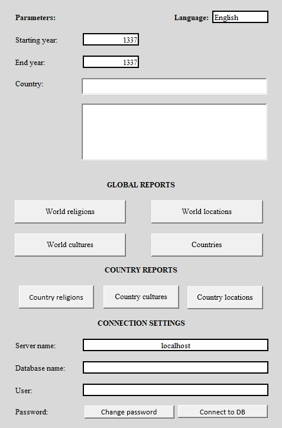
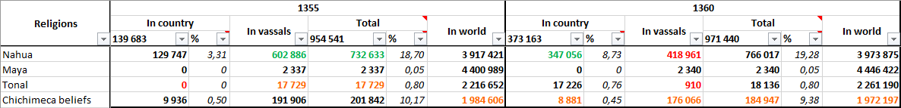
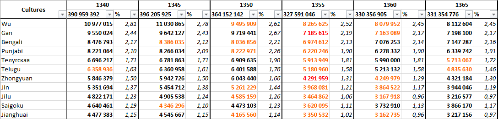

# EU5Statistics: Excel Reports (XLSM)

[English](XLSM_GUIDE.md) | **Русский**

Этот документ описывает, как использовать Excel-файл с макросами (XLSM) для визуализации и анализа данных, собранных Python-парсером в базу данных PostgreSQL. 

XLSM-файл выступает в роли клиента, который подключается к базе данных через ODBC, выполняет SQL-функции и строит готовые аналитические отчеты.

📥 **Скачать Excel-файл:** [EU5Statistics.xlsm (последний релиз)](https://github.com/EArboles/EU5Statistic/releases/latest/download/EU5Statistics.xlsm)

## Требования

1. **Microsoft Excel** (2016 или новее, Windows). *Внимание: в LibreOffice или онлайн-версии Excel макросы VBA и подключение к БД работать не будут.*
2. **База данных PostgreSQL**, заполненная Python-парсером (должны быть выполнены миграции и обработано хотя бы одно сохранение).
3. **ODBC-драйвер PostgreSQL** (psqlODBC). Если он не установлен, Excel-файл при запуске сам предложит его установить.

## Первый запуск (Настройка подключения)

1. Откройте файл `EU5Statistics.xlsm` и обязательно нажмите **«Включить содержимое»** (Enable Content), чтобы разрешить работу макросов.
2. **Проверка ODBC:** При первом запуске макрос проверит наличие ODBC-драйвера. Если его нет, появится диалоговое окно с предложением:
   * Перейти на страницу загрузки драйвера.
   * Указать путь к локальному установочному файлу `.msi`.
   * Пропустить (если вы хотите настроить всё позже).
3. Перезапустите Excel после установки драйвера.
4. На листе **Main** заполните блок **НАСТРОЙКИ ПОДКЛЮЧЕНИЯ**:
   * **Имя сервера**: `localhost` (или IP-адрес сервера).
   * **Имя базы данных**: имя вашей базы данных (например, `eu5statistic`).
   * **Пользователь**: имя пользователя PostgreSQL.
   * **Пароль**: нажмите кнопку *Сменить пароль*, введите пароль и подтвердите его.
5. Нажмите кнопку **Подключиться к БД**. При успешном подключении макрос загрузит справочник стран из БД, и станут доступны все отчеты.

## Интерфейс (Лист Main)

На листе `Main` расположены все элементы управления:

### Параметры
* **Начальный год/ Конечный год**: начальный и конечный года для анализа.
* **Выбранная страна**: поле для ввода тега или названия страны. 
  * Под полем ввода расположен динамический список, который фильтруется по мере ввода (autocomplete).
  * В нижней панели можно **выбрать несколько стран**.
  * *Зачем это нужно:* в игре страны меняют теги (например, Москва превращается в Россию). Чтобы отчеты не были «рваными», вы можете выбрать оба тега (например, `MOS` и `RUS`), и система соберет непрерывную историю за весь период.

### Общемировые отчеты 
Четыре кнопки для генерации глобальных отчетов:
* **Религии мира** 
* **Культуры мира** 
* **Локации мира** 
* **Страны**

### Отчеты по стране 
Три кнопки для детального анализа выбранной страны (или стран):
* **Религии страны** 
* **Культуры страны** 
* **Локации страны**

## Описание отчетов

Каждый отчет генерируется на основе SQL-функций (см. `src/eu5statistic/db/functions.py`) и агрегирует данные за выбранный период.

### Общемировые отчеты

*   **Религии мира**
    *   *Данные:* Динамика численности населения по каждой религии в мире.
    *   *Формат:* Таблица по годам (столбцы) и религиям (строки). Отображается абсолютное число населения и его доля в процентах от общемирового.
*   **Культуры мира**
    *   *Данные:* Динамика численности населения по каждой культуре.
    *   *Формат:* Аналогично религиям — абсолютные числа и проценты по годам.
*   **Локации мира**
    *   *Данные:* Сводная статистика по всем локациям мира.
    *   *Формат:* Общее население локации, доля в процентах от общемирового и средняя грамотность.
*   **Страны**
    *   *Данные:* Сводная таблица по всем странам мира.
    *   *Формат:* Общее население страны, процент титульной (основной) культуры, процент основной религии и количество контролируемых локаций.

### Отчеты по стране

*Эти отчеты строятся только для стран, выбранных в параметре «Выбранная страна».*

*   **Религии страны**
    *   *Данные:* Многогранный анализ религиозного состава выбранной страны (или суммы выбранных тегов) с учетом её вассалов.
    *   *Формат:* Таблица по годам. Для каждой религии выводятся четыре колонки:
        *   **В стране** — абсолютное число населения и его доля в процентах от населения самой страны.
        *   **В вассалах** — численность населения этой религии в государствах-вассалах.
        *   **Итого** — суммарное население религии (страна + вассалы) и его процент от общего населения страны и её вассалов вместе.
        *   **В мире** — общее население этой религии во всем мире (для контекста и сравнения).
*   **Культуры страны**
    *   *Данные:* Аналогичный многогранный анализ культурного состава страны с учетом её вассалов.
    *   *Формат:* Таблица по годам с колонками:
        *   **В стране** — абсолютное число населения культуры и её процент от населения страны.
        *   **В вассалах** — численность населения этой культуры в государствах-вассалах.
        *   **Итого** — суммарное население культуры (страна + вассалы) и его процент от общего населения.
        *   **В мире** — общее население этой культуры во всем мире.
*   **Локации страны**
    *   *Данные:* Детальная статистика по каждой локации, принадлежащей стране.
    *   *Формат:* Название локации, общее население, средняя грамотность, а также процентное соотношение сословий (аристократы, горожане, крестьяне и т.д.).

## Генерация отчетов

1. Укажите годы и выберите страну (если генерируете отчет по стране).
2. Нажмите на нужную кнопку.
3. Макрос выполнит SQL-запрос к функциям из `functions.py`, получит данные и построит готовый отчет.

**Особенности отчетов:**
* В отчетах применяются группировки, формулы и **условное форматирование** (для наглядного выделения изменений).
* Данные по религиям и культурам отображаются в абсолютных числах и процентах.

## Локализация (Языки)

В правом верхнем углу листа `Main` есть выпадающий список языков (по умолчанию: English и Русский).
* Макрос переводит интерфейс, сообщения об ошибках, названия столбцов и отчетов.
* **Как добавить новый язык:** 
  Откройте скрытый лист `LISTS`, найдите именованную таблицу переводов. В заголовке таблицы (например, `D`, `E`, `F`) добавьте новый столбец, назовите его кодом языка (например, `German`) и заполните ключи переводов. Новый язык появится в выпадающем списке.

## Проверка данных (Валидация)

Реализована простая, но эффективная система проверки ввода:
* Ячейки годов принимают только целые числа больше 0.
* При запуске отчета проверяется, что начальный год не больше конечного.
* При запуске отчета по стране проверяется, что выбрана хотя бы одна страна.

## Скриншоты

### Главный экран (лист Main)

*Интерфейс управления: параметры, выбор стран, кнопки отчетов и настройки подключения к БД.*

### Пример отчета: Религии страны

*Многогранная аналитика: население религии внутри страны, в её вассалах, итоговые показатели и доля в мире.*

### Пример отчета: Культуры мира

*Детальная статистика по каждой культуре мира.*

## Возможные проблемы

* **Ошибка "Provider cannot be found"**: не установлен ODBC-драйвер. Скачайте его с официального сайта PostgreSQL.
* **Макросы заблокированы**: Проверьте настройки безопасности Excel (Файл -> Параметры -> Центр управления безопасностью -> Параметры центра управления безопасностью -> Параметры макросов -> Включить все макросы).
* **Данные не обновляются**: Убедитесь, что Python-парсер обработал новое сохранение и обновил материализованное представление (`REFRESH MATERIALIZED VIEW location_stats_view`).